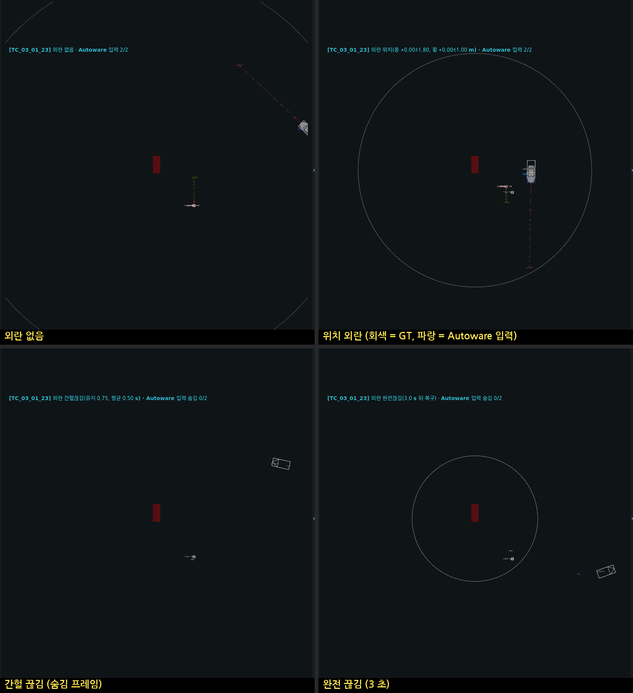

<!-- 26.11.24 _ YSH _ 신규. KATECH 공유본 README (외란 시각화 전용 Autoware, 다른 컴퓨터에서 받아 쓰는 사람용) -->
# MR_Morai-Autoware_Viz

**외란 시각화 전용 Autoware** 다.

KATECH 이 MORAI 에서 Ego 를 **직접 조종**하고, 시나리오 API 가 gRPC(cue)로 외란 명령(`SendCustomCommand`)을 보내면,
이 PC 가 그 외란을 MORAI 정답(GT) 객체에 걸어 **Autoware RViz 화면 그대로** 보여 준다.

- 주행 스택(측위 · 인지 · 계획 · 제어)은 들어 있지 않다. 화면에 필요한 패키지만 있다.
- 브리지는 **MORAI 에 아무것도 쓰지 않는다** (운전 명령 · 기어 · 모드 · 순간이동 · 방향지시등 모두 끔). MORAI 에서 읽기만 한다.
- 시나리오마다 bag 을 녹화하고, 나중에 MORAI 없이 다시 볼 수 있다 (지도를 얹어서도).



## 들어 있는 것

| 폴더 | 내용 |
| :--- | :--- |
| `src/` | Autoware 에서 화면에 필요한 84개 패키지 - RViz 플러그인, MORAI 브리지 `autoware_morai_interface`(외란 계산 포함), MORAI 메시지 `morai_ros2_msgs`(외란 메시지 추가판), 차량 모델, 지도 로더, `autoware_launch` 의 화면 파일(launch · rviz · 지도 파라미터) |
| `scripts/` | 실행 스크립트 `run_viz.sh` 와 빌드 · 셸 · 표시 노드 · cue 수신기 · 시험 도구 |
| `config/` | 브리지 설정 (MORAI 쓰기 끔) |
| `docs/` | 리허설 화면 |

## 1. 준비 (한 번)

- **Ubuntu 22.04 + ROS 2 Humble Desktop** (rviz2 · rosbag2 포함), `colcon`, `rosdep`.
- gRPC C++ (rosdep 으로 안 깔린다)

```bash
sudo apt-get install -y libgrpc++-dev protobuf-compiler-grpc
```

## 2. 받기 · 빌드 (한 번)

```bash
git clone https://github.com/Proejct-MR-2026/MR_Morai-Autoware_Viz.git
cd MR_Morai-Autoware_Viz
source /opt/ros/humble/setup.bash
rosdep install -y --from-paths src --ignore-src --rosdistro humble
pip install -r requirements.txt
scripts/viz_build.sh viz
```

- 받는 위치와 상위 폴더 이름은 아무거나 괜찮다. 스크립트가 자기 위치에서 찾는다.
- `viz_build.sh viz` 는 깨끗한 환경에서 84개 패키지를 빌드하고 끝에 `rc=0` 과 로그 위치를 보여 준다. 실패하면 그 로그 끝을 본다.
- **빌드한 뒤에는 폴더를 옮기거나 이름을 바꾸지 않는다** (`--symlink-install`). 옮겼으면 `scripts/viz_build.sh viz` 를 다시 한다.

## 3. 실행

**먼저 MORAI 쪽**
- MORAI 에 맵을 올리고 Ego(이름 `Ego`)를 둔다. MORAI gRPC(포트 `7789`)가 켜져 있어야 한다.
- KATECH 시나리오 API 가 외란 명령을 **이 PC 의 IP:50052** 로 보내게 한다.

```bash
cd MR_Morai-Autoware_Viz
MORAI_SIM_ADDRESS=<MORAI PC IP> MORAI_CUE_ADDRESS=<READY 받는 곳 IP:50052> scripts/run_viz.sh start
scripts/run_viz.sh status     # 떠 있는 것 · 포트 · MORAI 도달 · 수신기 로그
scripts/run_viz.sh stop       # 끄기 (외란 지우기 · 녹화 닫기 → 나머지)
```

- `start` 는 브리지 → 표시 노드 → cue 수신기(`50052`) → Autoware RViz 순서로 띄운다.
- 시나리오가 오면(SendCue) **1초 뒤 READY 를 자동으로 보낸다**. 외란 명령은 받는 즉시 건다.
- 시나리오 시작과 끝(END)에 외란을 모두 지운다. 다음 시나리오로 넘어가지 않는다.
- 받은 명령을 실시간으로 보려면 다른 터미널에서
  `scripts/viz_shell.sh -c 'python3 -B diag/dist_watch.py --log-dir <data 폴더>/cue_logs --flips'`

**환경변수** (필요한 것만 준다)

| 이름 | 기본값 | 뜻 |
| :--- | :--- | :--- |
| `MORAI_SIM_ADDRESS` · `MORAI_SIM_PORT` | `10.10.10.1` · `7789` | MORAI gRPC 주소 |
| `MORAI_CUE_ADDRESS` | `<MORAI_SIM_ADDRESS>:50052` | READY 를 받는 KATECH CueService |
| `VIZ_CUE_PORT` | `50052` | 이 PC 가 외란 명령을 받는 포트 |
| `VIZ_READY` | `auto` | `auto` SendCue 1초 뒤 자동 · `off` 보내지 않음 |
| `VIZ_RECORD` | `scenario` | `scenario` 시나리오마다 bag · `session` 켜 있는 동안 하나 · `off` |
| `VIZ_DATA` | `<저장소>/data` | 기록 위치 |
| `VIZ_DOMAIN` | `13` | ROS 도메인 (이 PC 안에서만 통신, `ROS_LOCALHOST_ONLY=1`) |
| `VIZ_NO_RVIZ` | (없음) | `1` 이면 RViz 없이 |
| `MAP_PATH` | (없음) | Lanelet2 지도 폴더. 주면 차선을 같이 그린다 |

## 4. 외란 명령 (`SendCustomCommand(Type, Value)`)

| Type | Value (켜기) | 하는 일 |
| :--- | :--- | :--- |
| `position` | `[종편향 m, 종표준편차 m, 횡편향 m, 횡표준편차 m]` | 객체 위치를 흔든다 |
| `dropout` | `[유지확률 0~1, 평균 끊김 s]` | 객체가 이따금 사라진다 |
| `blackout` | `[지속 s, 복구 1 또는 0]` | 객체가 전부 사라진다 |

- **끄기는 같은 Type 에 `Value="clear"`** 다.
- 답 `success` 는 "받았고 읽을 수 있다"는 뜻이다. `heading` · `mount` 는 아직 지원하지 않아 `success=false` 다.
- 범위: |편향| ≤ 100 m, 표준편차 0~100 m, 평균 끊김 ≤ 600 s, 지속 0~3600 s.
- 모든 객체에 걸린다. 난수 시드는 시나리오마다 새로 정하고 기록에 남긴다.

## 5. 화면

RViz 설정은 **Autoware 기본 `autoware.rviz` 그대로**이고, 맨 끝에 디버그 그룹 `Disturbance (외란 · GT)` 하나만 더했다.

| 보이는 것 | 뜻 |
| :--- | :--- |
| 자차 모델 · 극좌표 격자 · 속도 / 조향 / 기어 / 깜빡이 | MORAI Ego |
| **파란 차량 상자 · 예측 경로** (Perception › Prediction) | **외란 뒤** 객체 = Autoware 가 받는 입력. 경로는 등속 직선 5초 |
| **회색 반투명 상자** (Disturbance › GroundTruth) | **GT** = MORAI 정답 위치 |
| 왼쪽 위 한 줄 (Disturbance › DisturbanceStatus) | `[시나리오] 외란 … · Autoware 입력 n/GT m` |

- 위치 외란이면 파란 상자가 회색에서 떨어져 흔들린다. 끊김(dropout · blackout)이면 파란 상자와 경로가 사라지고 회색만 남는다.
- 지도가 없으면 시점이 자차를 따라간다. 객체가 화면 밖이면 마우스 휠로 줌 아웃.
- AD API 패널(AutowareStatePanel 등)은 비어 있는 것이 정상이다 (주행 스택을 띄우지 않는다).

## 6. 기록과 다시 보기

| 위치 (`VIZ_DATA`, 기본 `data/`) | 내용 |
| :--- | :--- |
| `bags/<시나리오>_<시각>/` | 시나리오마다 bag (GT · 외란 전후 · 외란 상태 · Ego · 차량 상태 · TF) + `viz_run.json` |
| `cue_logs/viz_<시각>.dist.jsonl` | 받은 명령 원문 · 해석 · 적용 시간 |
| `logs/` | 프로세스별 화면 로그 (`cue_server_*` · `bridge_*` · `display_*` · `rviz_*`) |

```bash
scripts/run_viz.sh replay data/bags/<bag 폴더>                              # MORAI 없이 다시 보기
MAP_PATH=<lanelet2 지도 폴더> scripts/run_viz.sh replay data/bags/<bag 폴더>   # 지도를 얹어서
```

- bag 좌표 = MORAI 월드 좌표다. 같은 월드의 Lanelet2 지도를 얹으면 차선이 맞게 겹친다.
- bag 을 다른 도구로 열 때는 이 저장소를 빌드한 셸(`scripts/viz_shell.sh`)에서 연다. `morai_ros2_msgs` 외란 메시지가 있어야 읽힌다.
- 시나리오 없이 명령만 오면 `viz_nocue_<시각>` 으로 녹화하고 마지막 명령 30초 뒤 닫는다.

## 7. 문제가 생기면

| 증상 | 할 일 |
| :--- | :--- |
| `★ … 빌드가 안 돼 있다` | `scripts/viz_build.sh viz` |
| `★ :50052 를 다른 프로그램이 쓰고 있다` | 50052 를 쓰는 다른 cue 서버를 끈다 (`ss -ltnp \| grep 50052`) |
| 한 줄 글자가 "브리지 객체 프레임이 오지 않는다" | MORAI gRPC · Ego 확인. `data/logs/bridge_*.log` 에 MORAI 연결 줄이 있는지 |
| 명령이 "거절" | `data/cue_logs/*.dist.jsonl` 의 받은 원문(`ref`) · 이유(`reason`) |
| 빌드 중 `morai_grpc_vendor requires the gRPC C++ runtime` | 1장의 `apt-get install` |

## 8. MORAI 없이 리허설

가짜 MORAI 와 가짜 시나리오 API 로 흐름 전체를 이 PC 안에서 돌려 본다. 실제 포트(7789 · 50052)는 쓰지 않는다.

```bash
cd MR_Morai-Autoware_Viz
setsid -f nohup build/morai_grpc_vendor/fake_morai_server --port 17881 > /tmp/fake_morai.log 2>&1 < /dev/null
VIZ_DOMAIN=91 MORAI_SIM_ADDRESS=127.0.0.1 MORAI_SIM_PORT=17881 MORAI_CUE_ADDRESS=127.0.0.1:17896 \
  VIZ_CUE_PORT=17895 VIZ_DATA=/tmp/viz_rehearsal scripts/run_viz.sh start
VIZ_DOMAIN=91 scripts/viz_shell.sh -c "python3 -B cue_sim.py --ads 127.0.0.1:17895 --listen 127.0.0.1:17896 \
  --out /tmp/viz_rehearsal/sim --scenario TC_03_01_23 --sim-time 36 --send-running \
  --custom '2:position:[0,1.8,0,1]' --custom '12:position:clear' --custom '14:dropout:[0.75,0.5]' \
  --custom '26:dropout:clear' --custom '28:blackout:[3,1]'"
VIZ_DOMAIN=91 VIZ_DATA=/tmp/viz_rehearsal scripts/run_viz.sh stop
pkill -INT -f fake_morai_server
```

- `--custom '<초>:<Type>:<Value>'` 가 시나리오 시작 뒤 그 초에 외란 명령을 보낸다.

## 9. 파일

| 파일 | 하는 일 |
| :--- | :--- |
| `scripts/run_viz.sh` | start · stop · status · replay |
| `scripts/viz_build.sh` | 빌드 (`viz` 보통, `pkg <이름>` 하나만) |
| `scripts/viz_shell.sh` | 이 저장소 설치본만 source 한 셸 (`-c '명령'` 으로 한 번만) |
| `scripts/viz_autoware.py` | 표시 노드 - 예측 객체 · GT · 상태 한 줄 · 시점 TF |
| `scripts/viz_cue_server.py` | gRPC CueService 수신기 (SendCue · END · SendCustomCommand → 브리지) |
| `scripts/make_rviz.py` | `autoware.rviz` + 디버그 그룹 → `autoware_disturbance.rviz` (`--check` 로 대조) |
| `scripts/cue_sim.py` | 시험용 가짜 시나리오 API |
| `scripts/cue/` · `scripts/disturbance/` · `scripts/diag/` | gRPC 스텁 · 명령 해석기 · 실시간 보기 |
| `config/viz_bridge.param.yaml` | 브리지 설정 (제어 · 모드 · 순간이동 · 등화 끔) |
| `src/launcher/autoware_launch/autoware_launch/launch/viz_disturbance.launch.xml` | 화면 launch (Autoware e2e_simulator 의 RViz 부분과 같은 파일 · 인자) |

## 라이선스

`src/` 는 [Autoware](https://github.com/autowarefoundation/autoware) (Apache License 2.0)에서 가져왔다. `LICENSE` · `NOTICE` 참고.
MORAI 브리지와 외란 기능은 충북대학교가 더했다.
